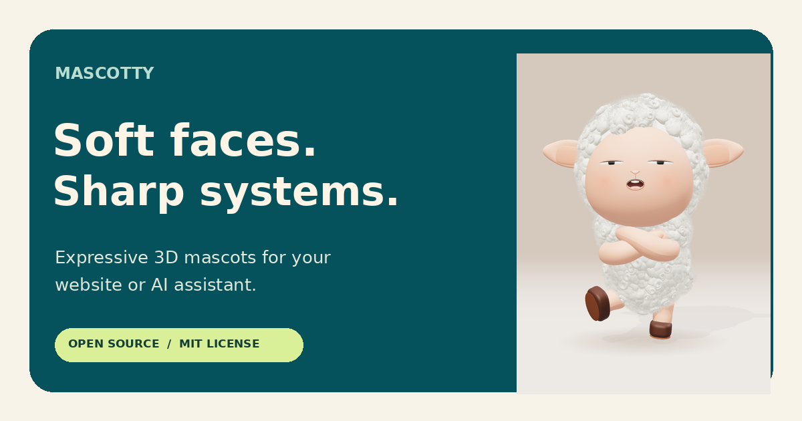

<div align="center">
  
  <h1>Mascotty</h1>
  <p><strong>Soft faces for sharp systems.</strong></p>
  <p>Expressive, open-source 3D mascots for websites and AI assistants.<br />Built by the community, for the community.</p>
  <p>
    <a href="https://kushwaha-pankaj.github.io/cute-orb/">Live studio</a> ·
    <a href="https://kushwaha-pankaj.github.io/cute-orb/docs/quick-start/">Documentation</a> ·
    <a href="https://github.com/kushwaha-pankaj/cute-orb/issues">Report an issue</a> ·
    <a href="CONTRIBUTING.md">Contribute</a>
  </p>
  <p>
    <a href="LICENSE"></a>
    
    <a href="https://github.com/kushwaha-pankaj/cute-orb/actions/workflows/deploy-visage.yml"></a>
  </p>
  
</div>

## What you can build

Give your app a character that listens, thinks, speaks or reacts to your own events. Mascotty is a browser-based character studio and embed controller. It runs without an account, API key or backend; connect your own assistant or audio pipeline when you need one.

- Customise expressions, colours, poses and animation in the live studio.
- Copy an HTML embed, JavaScript example or React component with your settings included.
- Drive supported states, expressions and audio levels through a small event API.
- Share a configuration link, use transparent embeds, and self-host the static build.
- Explore searchable developer guides with API, deployment and contribution instructions.

| Character | Rendering | Controls |
| --- | --- | --- |
| Mallow | Procedural wool sheep | Expressions, poses, assistant states, visemes and PNG capture |
| Green Blob | Clay-style glTF character | Expressions, appearance and individual body parts |
| Portrait | Particle face that transforms into an orb | Assistant states, audio levels and particle appearance |

Capabilities vary by character. Use the [character reference](https://kushwaha-pankaj.github.io/cute-orb/docs/characters/) before wiring events.

## Quick start

**Requirements:** Node.js 22 or later, npm, and a recent browser with WebGL and hardware acceleration.

```sh
git clone https://github.com/kushwaha-pankaj/cute-orb.git
cd cute-orb/visage
npm ci
npm run dev
```

Open the address printed by Vite. Pick a character, then choose **Use on your site** to get the integration code. Microphone access requires a secure context; the app measures audio levels locally and does not record or upload microphone audio.

### Add a mascot to your website

```html
<div data-mascotty="mallow" style="width:320px;height:400px"></div>
<script src="https://kushwaha-pankaj.github.io/cute-orb/mascotty.js"></script>
<script>
  const mascot = Mascotty.get('mallow');
  mascot.setState('listening');
</script>
```

Load the script before calling `Mascotty`. Commands queue while the iframe initialises. See [quick start](https://kushwaha-pankaj.github.io/cute-orb/docs/quick-start/) for readiness and error handling, or [React integration](https://kushwaha-pankaj.github.io/cute-orb/docs/react/) for component lifecycle and cleanup.

## Build and verify

Run these commands from `visage/`:

```sh
npm test
npm run build
npm run preview
```

The build runs the regression checks and creates `dist/`, including pre-rendered HTML for the landing page and every guide, a sitemap, social metadata, embed loaders and character assets. Publish the complete directory over HTTPS. Studio and embed URLs retain hash routing; documentation uses directory URLs.

For a subdirectory or custom domain:

```sh
VISAGE_BASE=/characters/ VITE_PUBLIC_SITE_URL=https://example.com/characters npm run build
```

`VISAGE_BASE` controls the asset path and must end in `/`. `VITE_PUBLIC_SITE_URL` sets the canonical and integration host. See [deployment](https://kushwaha-pankaj.github.io/cute-orb/docs/deployment/) for hosting and verification. GitHub Pages deploys eligible changes pushed to `main`.

## Project structure

```text
visage/
  src/mascots/       Character registry, definitions and control schemas
  src/studio/        Shared studio and integration panel
  src/embed/         Iframe rendering and message handling
  src/docs/          Developer documentation and searchable guide content
  src/integration.js  Generated snippets, settings codec and share links
  public/           Hosted loaders, fonts, images and character assets
  scripts/          Static HTML and SEO generation
  tests/            Integration, documentation and rendering regressions
mascot/green-blob/   Blender source and generation script
inspiration/        Reference material; separate rights may apply
```

The application uses React, Vite and Three.js. Renderers load separately from the initial page, pause outside the viewport and release resources on unmount. Developer documentation is presented as web pages; repository Markdown is not shipped as website content.

To regenerate the Blender source asset, use Blender with Python support:

```sh
cd mascot/green-blob
blender --background --factory-startup --python build_green_blob.py
```

Regenerating the source does not automatically replace the optimised web asset. Preserve mesh names and verify every expression before updating it.

## Contributing and support

Code, documentation, accessibility improvements, character art and bug reports are welcome. Read [CONTRIBUTING.md](CONTRIBUTING.md) for setup, checks and licensing expectations, and [the mascot rulebook](visage/MASCOT_RULEBOOK.md) before changing a renderer.

Use [GitHub issues](https://github.com/kushwaha-pankaj/cute-orb/issues) for reproducible bugs and feature proposals. Include your browser, OS, character and steps to reproduce. Check the [troubleshooting guide](https://kushwaha-pankaj.github.io/cute-orb/docs/troubleshooting/) first for rendering and integration problems.

## License and credits

Original project code is available under the [MIT license](LICENSE), including commercial reuse with the required copyright and license notice. Third-party dependencies, fonts, artwork and inspiration references retain their own licenses. See [license and credits](https://kushwaha-pankaj.github.io/cute-orb/docs/license/) and the [Helvetiker font notice](visage/public/fonts/helvetiker-license.txt).
